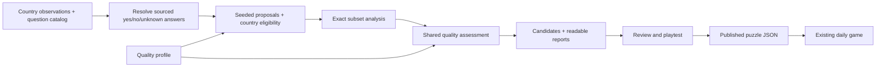

# Authoring and inspecting puzzles

The generator is an offline authoring tool. Players receive the reviewed definitions in `src/content/puzzles.json`; the browser does not generate a new board on each visit. No external service, new dependency or database is required.



The layers have separate responsibilities:

- `requirements.ts` establishes factual answers from pinned observations and reviewed event records. Unknown data remains unknown.
- `eligibility.ts` decides which countries may appear for a chosen question set. Every comparison reference is automatically excluded, even if its factual answer is clearly false. `excludedEntityIds` adds other editorial exclusions.
- `validator.ts` measures every country subset, without deciding whether a board is interesting.
- `quality.ts` applies the settings in `quality-profile.json`. Both the generator and `audit.ts` use these checks; hand-authored puzzles must pass too.
- `generator.ts` proposes boards within a finite attempt budget and records rejection reasons. Its output is the existing puzzle definition format, so future search strategies can replace it without changing gameplay or the assessor.

## Commands

Audit the current published week:

```sh
npm run puzzles:audit
npm run puzzles:audit -- --report /tmp/quorum-audit.json
```

Generate another week for inspection:

```sh
npm run puzzles:generate -- --seed 20261022 --count 7 --attempts 100000 \
  --output /tmp/quorum-candidates.json --report /tmp/quorum-generation.json
npm run puzzles:audit -- --input /tmp/quorum-candidates.json
```

`--report` writes JSON plus a companion `.md` report. The Markdown includes the active settings, question mix, excluded countries, answer matrix, exact solution counts, optimal solutions and a conservative route for each board. Generation reports also include stage totals and rejection counts. JSON contains detailed traces of the first 30 attempts by default; change this with `--trace 100`, or use `--trace 0` to omit traces. Traces distinguish excluded countries, unverified relationships (with question IDs), and countries covering no question. Failed checks include actual values and thresholds where applicable. A rejected attempt can fail several checks, so rejection totals can exceed the attempt count. Stage totals count every attempt exactly once.

Generation has no publication side effect unless an output path is explicitly provided. Budget exhaustion exits with status 1 and retains any partial candidates and reports; it never weakens a constraint. The seed, algorithm version, catalog version, profile snapshot, budget and attempt count are recorded. The same inputs and code reproduce the same output, without clocks or network calls. The checked-in [generation report](puzzle-quality-report.md) describes the current week; its JSON companion preserves the detailed results.

Both commands accept `--profile path/to/profile.json`. This makes it possible to try stricter or looser policies without editing the active profile. `--help` shows all options. Reports contain answers and are intended for content authors.

## What the settings mean

A requirement has three independent classifications:

| Field | Purpose | Examples |
| --- | --- | --- |
| `category` | Subject variety | geography, sport, culture, economy, population |
| `family` | Prevent repeated question formats | continent, capital-distance, numeric-comparison, event-hosting |
| `reasoning` | Limit estimation across different formats | recall, estimation |

Thus GDP comparisons and capital distances count together towards the estimation cap, even though they have different families. Summer and Winter Olympic hosting share the event-hosting family; winning a World Cup is sporting-achievement. Adding a new instance of an existing format should retain its family. Metadata is authored and reviewed alongside the wording, not inferred from labels.

`difficulty` is an editorial easy/medium/hard band. Country `familiarity` is an editorial familiar/moderate/less-familiar band for the current general English-speaking test audience. These are starting assumptions, not measured player knowledge. They can later be calibrated from playtesting without changing factual answers.

The current profile requires twelve countries, six questions, at most two per family, one or two estimation questions, at least three subjects, all three difficulty bands, and a mix including four to eight familiar and two to four less familiar countries. Each question needs two to seven matching countries; every country must contribute. No question may automatically imply another on that board.

There must be one to four optimal triples. Completion-rate bands constrain fours, fives and sixes using **complete combinations / all combinations of that size**. For twelve countries, the denominators are 220 triples, 495 fours, 792 fives and 924 sixes. This makes the thresholds interpretable and reusable if candidate counts change. These structural rates do not predict player score distributions.

An **irreducible** solution loses coverage whenever any country is removed. An **optimal** solution has the smallest possible size. An irreducible five can coexist with an optimal triple: moving between them requires replacing countries. The profile requires irreducible fours and fives, plus a stored irreducible five- or six-country conservative route. Reports also show the fraction of complete selections that are prunable. Every superset of a winning triple is necessarily prunable; forbidding all such larger solutions would be incompatible with this game's coverage rules.

Adjacent days may share at most four questions, including the last-to-first boundary of the looping testing schedule. Duplicate question sets are rejected. This is a small schedule-level check, separate from the quality of an individual board. There is currently no requirement that every catalog country or question appear each week; reports show batch coverage so omissions are visible.

## How the current search works

Each attempt performs the following steps, in order:

1. Draw one or two estimation questions, then enough recall questions to make six, using the seeded random stream. Disabled questions are omitted. Reject question sets that fail the cheap family, subject or difficulty checks, repeat an accepted question set, or exceed adjacent-day overlap.
2. Exclude reference countries and explicit exclusions. Keep only countries with verified answers to every chosen question and at least one positive answer. Reject pools too small for twelve candidates.
3. Try to build an irreducible five- or six-country route. Choose a distinct *private requirement* for each country: within this route, only that country may cover that requirement. The remaining requirements may overlap. Test the finite possible private-requirement sets, with at most four seeded draws per set. Reject the attempt if this heuristic finds no complete route.
4. Fill the remaining country slots from the eligible pool and shuffle the board. Reject an unsuitable familiarity mix.
5. Analyse all 4,095 non-empty country subsets. Apply the full quality profile, including match frequencies, implications, optimal count, completion rates and irreducible routes. Keep the board only if every check passes.
6. Repeat until the requested count is reached or the attempt budget runs out. Greedy acceptance means an early accepted board can make later schedule choices harder. No backtracking or global search is implemented.

Building a conservative route first helps avoid spending time solving boards with no route of the intended shape. Failure to propose one is **not proof** that no suitable board exists. The report distinguishes this proposal failure from an exact solver rejection. This search samples possibilities; it does not enumerate every country/question combination or guarantee an unbiased sample. The profile and exact assessor can be reused later with a better proposal search, measured difficulty, swap-distance checks or broader schedule balancing.

## Adding content and promoting a week

Add observations, reviewed manual facts, event coverage and source references in `countries.json`. Add question definitions, family, reasoning, category and difficulty. Add country familiarity metadata. Existing rule formats and metadata need JSON edits only; a new factual rule format needs compiler code. Unknown relationships make a country ineligible for that particular proposal. Never manufacture false answers to increase the eligible pool.

For example, a numeric comparison has `rule.referenceId: "germany"`; Germany is excluded automatically. A question can additionally contain `"excludedEntityIds": ["some-country-id"]`. Unknown exclusion IDs are errors. Exclusion does not alter that country's factual answer in the catalog. `generationEnabled: false` retains a question's data while preventing publication under the quality policy; the specific 1980 regime question is disabled this way.

Review generated wording, scope and source accuracy, inspect the report, then play several routes. Copy the reviewed candidate schedule into `src/content/puzzles.json` and run `npm run check` and `npm run puzzles:audit`. Preserve the intended UTC epoch when replacing a schedule. If editing a previously used puzzle ID, bump its version; changing observations or factual answers also requires a catalog version bump. Seed and sequence IDs are authoring identifiers, so reusing a seed after changing the algorithm/profile still requires normal version review. The stored profile snapshot records provenance; the active profile controls publication checks.

The browser loader enforces factual completeness, references, exclusions and solvability. The content test gates the whole published schedule against the active quality policy before a production build. The assessor cannot establish factual truth or enjoyment; those remain matters for source review and playtesting.
